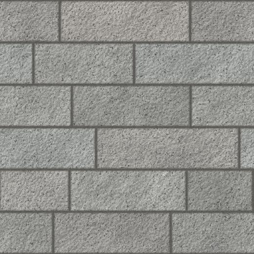

# Natural-Stone-Impex

Inventory and order management for **Natural Stone Impex**, a Bulgarian natural-stone and building
materials shop: a public storefront (catalog, cart, orders, product visualizer) and an admin panel
(products, categories, orders, invoices). All UI text is in Bulgarian.

- **Client:** Blazor WebAssembly + Bootstrap 5 — `src/NaturalStoneImpex.Client`
- **API:** ASP.NET Core 10, EF Core 10, SQL Server, JWT — `src/NaturalStoneImpex.Api`
- **Tests:** xUnit — `tests/NaturalStoneImpex.Api.Tests`; manual visualizer harness — `tests/manual`

Requirements, conventions and the task breakdown are in [`CLAUDE.md`](Claude.md) and [`docs/`](docs).

## Quick start

```bash
# one-time: download the segmentation models used by the visualizer
powershell -File scripts/download-visualizer-models.ps1

dotnet run --project src/NaturalStoneImpex.Api      # https://localhost:5001
dotnet run --project src/NaturalStoneImpex.Client   # https://localhost:5002
dotnet test
```

The database is migrated and seeded on API start-up (admin user `admin` / `Admin123!` in development).

## Product visualizer

`/visualizer` lets a customer upload a photo of their yard, tap the area to pave, and see it covered
with any visualizer-enabled product. The server only finds the area (MobileSAM segmentation, no
generative AI); everything the customer sees is rendered in the browser from the product's real
texture, with perspective, scale and the photo's shadows. Design and behaviour:
[`docs/visualizer-specification.md`](docs/visualizer-specification.md).

### Product textures

The result can only be as good as the product's texture image. Catalog photos (pallets, angled shots)
do not work; each product needs a **top-down, evenly lit, seamless photo of the real stone laid as
installed, with a known width in metres**.



| Document / tool | What it is for |
|---|---|
| [Visualizer Texture Standard](docs/visualizer-texture-standard.md) | What to photograph and how: spec (2048 × 2048 px JPG, 1–2 m real size, seamless, even light), shot list, kit, options compared (AI, 3D, stock), legal notes, rollout plan |
| [AI prompt](docs/visualizer-texture-ai-prompt.md) | Copy-paste prompt that turns the cropped photo into the texture without changing the stones, plus fix-up prompts |
| [Texture Prep Kit](tools/texture-prep-kit/texture-prep-kit.html) | Open in a browser: prompt builder, and a checker that compares the AI result with the original (changed stones, colour drift, uneven light, seams, size) |

Workflow per product:

1. Lay about 1.5–2.5 m² of the real stone, shoot straight down on an overcast day with tape measures
   and a colour card in the frame.
2. Crop the photo to an exact square between two tape marks; note the width (e.g. 1.5 m).
3. Run the AI prompt (new chat per product) and download the 2048 × 2048 JPG.
4. Check it in the Texture Prep Kit; fix with the fix-up prompts if needed.
5. Admin → product → upload under «Текстура за визуализатора» and set
   «Реална ширина на текстурата (м)».

A product with a dedicated texture is rendered exactly as uploaded. A product without one falls back
to its catalog photo, which the renderer repairs automatically (lighting flattened, made tileable,
repetition randomized) as a stop-gap.
