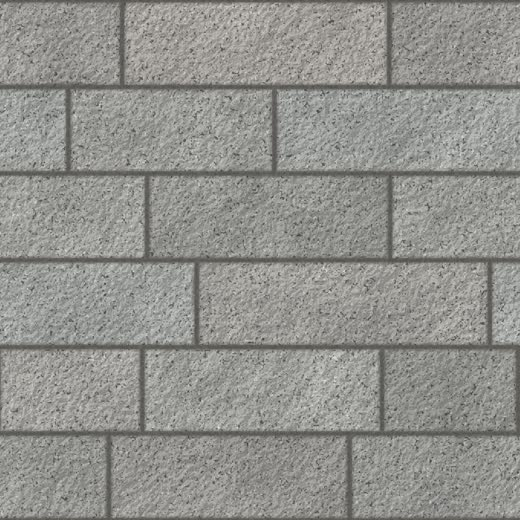

# Visualizer Texture Standard

How every м² product (paving, flagstones, setts, cladding) is photographed so it can be shown in the
yard visualizer (`/visualizer`) and in the catalog. Companion documents:

- **AI clean-up prompt and fix prompts:** [`visualizer-texture-ai-prompt.md`](visualizer-texture-ai-prompt.md)
- **Texture Prep Kit** (prompt builder + in-browser checker): [`../tools/texture-prep-kit/texture-prep-kit.html`](../tools/texture-prep-kit/texture-prep-kit.html)
- **How the renderer uses the texture:** [`visualizer-specification.md`](visualizer-specification.md) §5.2–5.3

*Target format (computer-generated example for «Бордюри», 1.00 m wide). Real photos of the real stone replace it.*

## Why

The visualizer tiles the product image across the customer's ground. Catalog photos (pallets, straps,
angled views, side light) produce a chaotic mosaic. A top-down, evenly lit, seamless image of the laid
product with a known real-world size renders as believable paving with correct perspective and scale.

## Recommendation in short

1. Photograph the **real stone, laid as it will be installed**, straight from above, in soft daylight,
   with tape measures and a colour card in the frame. One shoot gives both the catalog hero photo and
   the visualizer texture.
2. **AI only as an assistant:** lens and colour correction, removing uneven light and shadows, removing
   debris, making the edges tile. AI must never create, extend or "improve" the stone pattern (see
   [Legal](#legal)).
3. **No 3D scanning.** Paving is flat; the ground shape comes from the customer's photo. A relief
   (normal) map can be derived later from the archived photos if the renderer gets support for it.
4. **Pilot 3 products of different types first**, check them in the visualizer, then roll out.

## Deliverable 1: visualizer texture

| Property | Requirement |
|---|---|
| Content | The real product laid as installed, with real joints at the real width and colour. Dry stone. Nothing else in the image: no tape, colour card, edges, plants or shadow of the photographer. |
| View | Straight down (orthographic); perspective corrected so every stone has its true shape. |
| Real-world size | Regular formats (strips, setts, slabs): a square with whole pattern repeats, typically **1.0–1.5 m**. Irregular flagstones: **2.0 m** (min. 1.5 m). Enter the width in «Реална ширина на текстурата (м)». |
| Resolution | **2048 × 2048 px** (≥ 1000 px per metre). Keep the full-resolution master. |
| Seamless | Left edge continues into right, top into bottom. No visible seam when tiled 3 × 3. |
| Light | Flat and even: no cast shadows, highlights or darker corners. |
| Colour | Neutral, calibrated from the colour card, sRGB. Matches a real stone held next to the screen in daylight. |
| File | JPG, quality 90+, sRGB, ≤ 5 MB, named `NSI_{productId}_{name}_{size}m_albedo.jpg`, e.g. `NSI_84_bordyuri_1.5m_albedo.jpg`. |
| Upload | Admin → product → «Текстура за визуализатора». A dedicated texture is rendered exactly as supplied; a product without one falls back to its catalog photo with automatic repair. |
| Archive | Original photos (RAW if possible), the chart frame, and a note with size, joint width, date and stone batch. |

## Deliverable 2: catalog photos

| # | Photo | Purpose |
|---|---|---|
| 1 | Hero: about 1 m² of laid product from above, dry, soft daylight (can be a crop of the texture shoot) | Main product image, thumbnails |
| 2 | Single piece next to a ruler, plus an edge shot showing thickness and finish | Size and finish |
| 3 | Colour range: 4–8 pieces from the current batch side by side, with the batch date | Honest about natural variation |
| 4 | Wet and dry pair, same framing | Stone looks very different wet |
| 5 | Installed photo from a real project | Lifestyle context |

All real photos, ≥ 2000 × 2000 px, sRGB, no text or watermarks. Keep a note on the product page that
natural stone varies between batches and a sample can be ordered.

## How to shoot

1. **Lay the sample** on flat, level ground, a bit larger than the crop (about 1.5 × 1.5 m for regular
   formats, 2.5 × 2.5 m for irregular flagstones), with the real joint width and joint filling. Mix
   pieces from different pallets.
2. **Mark scale and colour:** measuring tapes along two edges; a colour card (ColorChecker) on the
   ground next to the sample, outside the crop.
3. **Light:** overcast day or the whole sample in shade. No direct sun, no flash. Dry stone.
4. **Shoot from above:** phone in RAW (ProRAW / Expert RAW) or a camera with a 35–50 mm lens, level,
   pointing straight down from a pole, ladder or tripod arm (≈ 2–3 m). Three frames plus one chart frame.
5. **Crop yourself** to an exact square between two tape marks (e.g. 0–150 cm). This fixes the real width.
6. **Clean up** with the AI prompt from [`visualizer-texture-ai-prompt.md`](visualizer-texture-ai-prompt.md),
   or manually (darktable for colour, offset + clone with whole stones for tiling).
7. **Check** the result with the Texture Prep Kit checker, compare with a real stone, test in the
   visualizer on two yard photos, then upload.

**Kit** (approx.): ColorChecker Passport/Classic Mini €75–120 · two 5 m tapes and a spirit level €20 ·
pole/tripod arm or a stable ladder €50–120 · phone with RAW or an existing camera · darktable and GIMP (free).

## Options considered

| Method | True to our stone | Effort / product | Verdict |
|---|---|---|---|
| Calibrated photo of a laid sample | Highest practical | 1–1.5 h | **Recommended** |
| + cross-polarized flash | Highest | +50%, at night/indoors | Only for shiny or mica-rich stone |
| + AI relief maps (Substance 3D Sampler, ~€58/month) | Colour kept, relief estimated | +10–20 min | Later, with renderer support |
| Multi-light capture (photometric stereo) | High | 1–2 h, small area | Area too small for joints |
| Photogrammetry / 3D scan / Gaussian splats | High | 2–4 h + processing | Overkill for flat paving |
| Generative AI creating or extending stone | Poor: invents stones and colours | 5–15 min | Not for product pixels |
| Stock or procedural textures | None: not our stone | Minutes | Labelled placeholders only |

## AI: allowed and not allowed

| Allowed (assistive) | Not allowed (creates stone) |
|---|---|
| Lens, perspective and colour correction | Generating or extending stone pattern |
| Removing uneven light, shadows, vignetting | "Make it look like a nicer stone" |
| Removing debris, tapes, leaves | Changing colour, veins or shapes of the product |
| Making edges tile within a narrow strip | Using AI-generated swatches as product photos |
| Deriving relief/roughness maps | |

## Legal

An image that makes the stone look different from what is delivered can be a misleading commercial
practice under the EU Unfair Commercial Practices Directive (applied in Bulgaria through the Consumer
Protection Act, ЗЗП). Since 2 August 2026 the EU AI Act (Art. 50) also requires disclosure of
AI-generated or AI-manipulated realistic images; summaries of the Commission's July 2026 guidelines say
product images altered to look different from reality need a label (secondary sources, not verified
against the primary text). Keeping AI to assistive edits avoids both. The visualizer shows
«Визуализацията е ориентировъчна…» under every result.

## Rollout

1. Buy the kit; shoot 3 pilots: «Бежов оформен 10L» (strips), «Каристо неоформен настилка» (irregular
   flagstone), «Павета за настилка» (setts). Test them in the visualizer and adjust this standard.
2. About 15 products per week, best sellers first. Products with the same visible surface (e.g. only
   thickness differs) can share one texture.
3. Renderer follow-ups: accept 2048 px textures (currently scaled to 1024 px), texture guidance in the
   admin form, a border band for curbs («Бордюри» is edging, not a surface), joint colour, wet look,
   relief maps.

## Sources

- Poly Haven scanning and colour calibration: <https://blog.polyhaven.com/?p=977>,
  <https://docs.polyhaven.com/en/technical-standards/texture-color-calibration>
- Poliigon texture specifications: <https://help.poliigon.com/en/articles/9612755-texture-specifications>
- Adobe Substance 3D Sampler: <https://experienceleague.adobe.com/en/docs/substance-3d-sampler/using/filters/tools/multiangle-to-material>
- Wizart tile texture requirements: <https://wizart.atlassian.net/wiki/spaces/WDP/pages/2801958989/TILE+requirements+for+textures+provided+by+the+client+for+visualization>
- Permacon seamless texture guide: <https://permacon.ca/wp-content/uploads/2022/05/guidetextures2023-amen-en.pdf>
- Marshalls Product Visualiser: <https://www.marshalls.co.uk/commercial/tools-and-support/product-visualiser>
- Google Merchant Center image requirements: <https://support.google.com/merchants/answer/6324350?hl=en>
- Unfair Commercial Practices Directive: <https://commission.europa.eu/law/law-topic/consumer-protection-law/unfair-commercial-practices-law/unfair-commercial-practices-directive_en>
